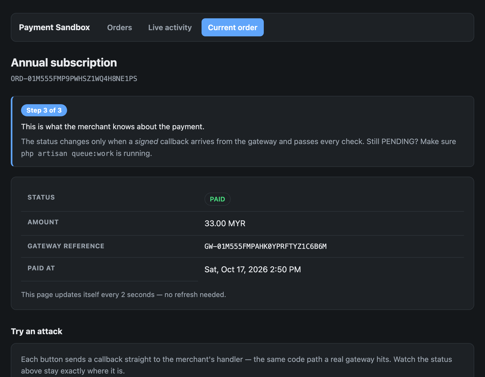
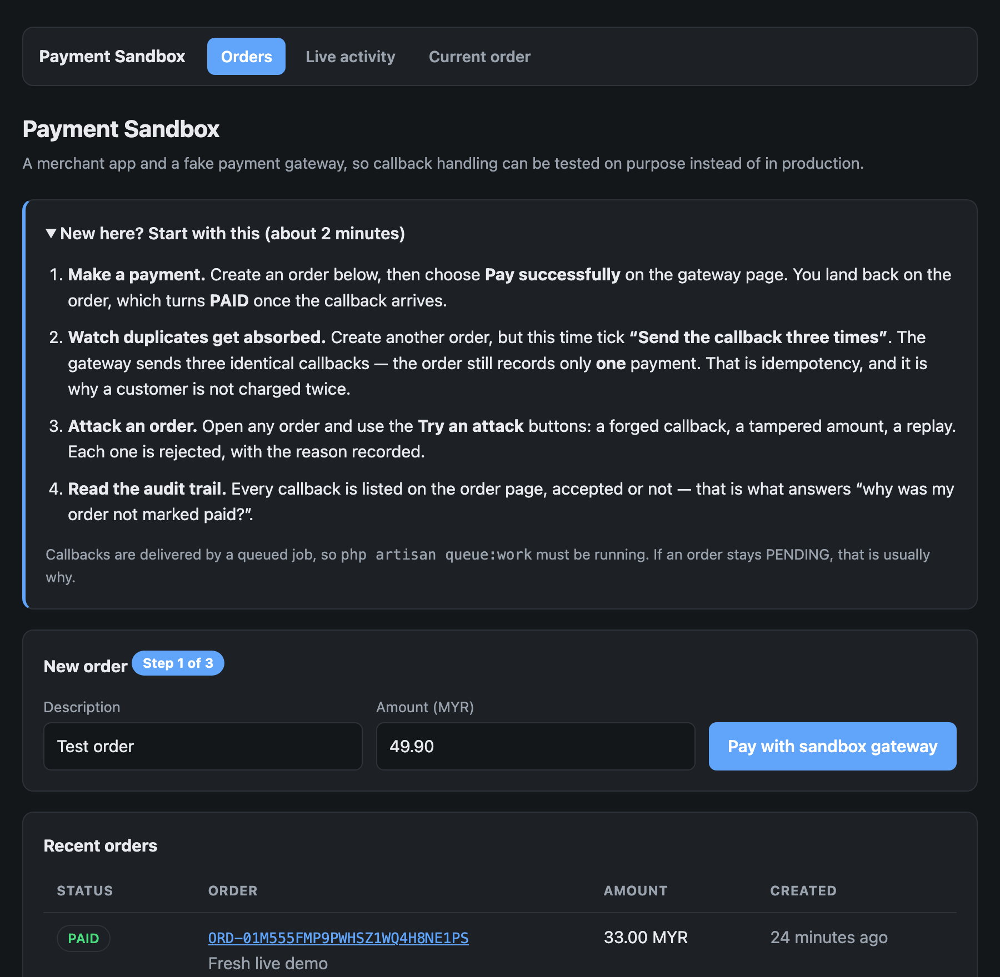
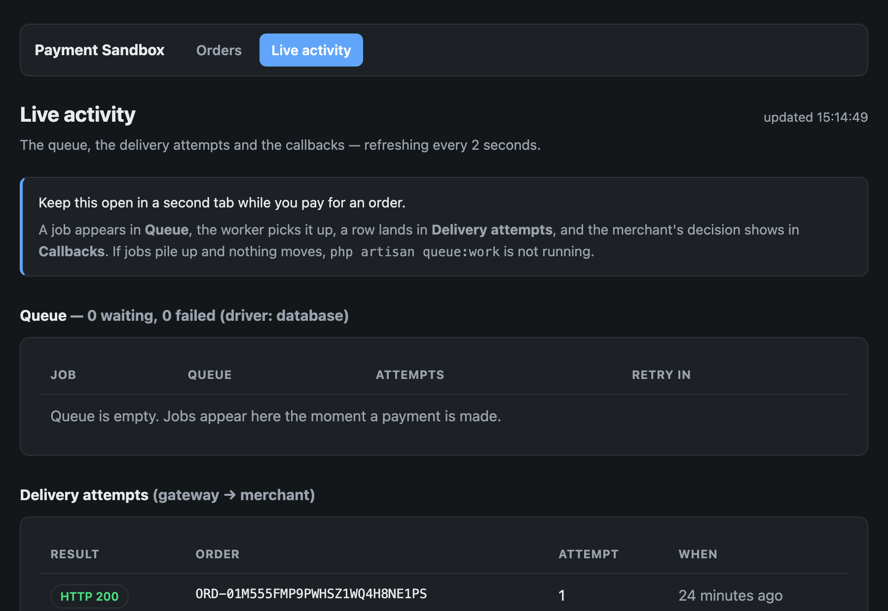

# Payment Sandbox


A Laravel sandbox for the part of a payment integration that actually goes
wrong: **the callback**.

Taking the payment is the gateway's job. Deciding whether to believe the
gateway is yours — and that is where orders get paid twice, or marked paid by
someone who never paid at all. This project pairs a merchant application with a
fake gateway so every awkward case — a forged callback, a replay, a duplicate,
a late failure — can be triggered on purpose and verified by tests.



## Features

- **Checkout flow** — create an order, get redirected to a hosted payment page,
  choose success or failure, return to the merchant
- **Signed callbacks** — HMAC-SHA256 over a canonical payload, verified with a
  constant-time comparison
- **Idempotent handling** — the same callback delivered five times pays the
  order once; duplicates are acknowledged with `200` so retries stop
- **Queued delivery with retries** — exponential backoff (10s → 30s → 2m → 10m)
  until the merchant acknowledges, with every attempt logged
- **Attack simulator** — fire a forged, tampered, mispriced, expired or
  replayed callback from the order page and watch it be rejected
- **Audit trail** — every callback, accepted or not, with its outcome and
  whether the signature was valid
- **Live pages** — the order page and an activity page update themselves, so
  queue jobs, delivery attempts and decisions can be watched as they happen
- **Guided walkthrough** — the home page explains what to click first
- **Production layer** — Docker Compose, a multi-stage image, CI running Pint,
  PHPStan (level 6) and 39 tests

## Why this exists

The happy path of a payment integration is easy. The money is lost in the edge
cases:

| Case | What happens without protection | Guard here |
|---|---|---|
| Forged callback | Anyone who knows an order reference can mark it paid | HMAC-SHA256 signature, compared with `hash_equals` |
| Tampered amount | Customer pays 1.00 for a 100.00 order | Signature covers the amount; it is also compared to the order |
| Replayed callback | An old captured callback pays a new order | Signed timestamp, rejected after 5 minutes |
| Duplicate delivery | Gateways retry; the order is paid twice | Unique `event_id` + row lock, applied exactly once |
| Out-of-order delivery | A late "failed" unpays a successful order | Paid and failed are final states |
| Wrong currency | 100 IDR settles a 100 MYR order | Currency compared before applying |

Every one of those is covered by a test, so the protections cannot quietly
disappear in a refactor.

## How it works

```
Merchant                        Sandbox gateway
--------                        ---------------
POST /orders
  creates order (pending)  ──▶  creates payment session
  redirect to hosted page  ──▶  GET /gateway/pay/{ref}
                                   customer picks an outcome
                                   queued job signs + POSTs the callback
POST /callbacks/payment   ◀──
  verify signature
  check freshness, amount, currency
  insert payment_event (unique event_id)
  apply once, then 200  ──────▶  delivery acknowledged, retries stop
```

The callback is delivered by a queued job, not during the browser request —
so `php artisan queue:work` must be running, and `/activity` shows what the
queue is doing.

The merchant answers **200 for duplicates too**. A gateway retries anything
that is not 2xx, so answering 4xx to a callback you already handled means hours
of pointless retries.

Amounts are integer cents everywhere. `0.1 + 0.2 !== 0.3` in binary floating
point, and money must be exact.

## Running it

With Docker (nginx + php-fpm + MySQL + Redis + a queue worker):

```bash
make up                      # http://localhost:8000
make fresh                   # demo data
```

Or locally with SQLite:

```bash
composer install
cp .env.example .env && php artisan key:generate
php artisan migrate --seed
php artisan serve            # terminal 1
php artisan queue:work       # terminal 2 — callbacks are delivered by the queue
```

Then open <http://localhost:8000>. The home page opens with a short guided
walkthrough; the pages update themselves, so nothing needs refreshing.



| Page | What it shows |
|---|---|
| `/` | Create an order; list recent ones |
| `/gateway/pay/{ref}` | The gateway's hosted page: succeed, fail, or send the callback three times |
| `/orders/{ref}` | One order, its live status and every callback it received |
| `/activity` | The queue, delivery attempts and decisions across the whole system |



## Trying the attacks

Each order page has **Try an attack** buttons that send a hostile callback to
the merchant's own handler:

| Button | Payload | Result |
|---|---|---|
| Forged | No signature | `401 invalid_signature` |
| Tampered | Signed, then the amount edited | `401 invalid_signature` |
| Wrong amount | Correctly signed, wrong amount | `422 amount_mismatch` |
| Expired | Correctly signed, an hour old | `401 expired` |
| Replay | The callback that already succeeded | `200 duplicate` — applied once |

The order's status never moves, and each attempt is recorded. The same thing
works from the command line:

```bash
curl -X POST http://localhost:8000/callbacks/payment \
  -H 'Content-Type: application/json' \
  -d '{"order_reference":"ORD-...","amount_cents":4990,"currency":"MYR","status":"success"}'
# → 401 {"outcome":"invalid_signature"}
```

The response always names the decision: `applied`, `duplicate`,
`order_already_final`, `invalid_signature`, `expired`, `unknown_order`,
`amount_mismatch`, `currency_mismatch`. Every callback is stored in
`payment_events`, rejected ones included — that audit trail is what answers
"why was my order not marked paid?".

## Layout

```
app/
├── Payments/
│   ├── Signature.php             HMAC signing, canonical form, constant-time compare
│   ├── ApplyPaymentCallback.php  all the rules, in one testable place
│   ├── GatewaySandbox.php        the fake gateway: sessions and signed callbacks
│   ├── OrderStatus.php           pending / paid / failed, with final-state logic
│   └── CallbackOutcome.php       every decision, with its HTTP status
├── Jobs/DeliverCallback.php      delivery with retries and backoff (10s → 10m)
├── Http/Controllers/
│   ├── CheckoutController.php    orders, plus the JSON the order page polls
│   ├── PaymentCallbackController.php  the endpoint a gateway calls
│   ├── GatewayController.php     the hosted payment page
│   ├── SimulationController.php  the attack buttons
│   └── ActivityController.php    live queue, deliveries and callbacks
└── Models/                       Order, PaymentEvent, GatewayPayment, CallbackDelivery
tests/
├── Unit/SignatureTest.php        canonical form, tampering, bad secrets
└── Feature/
    ├── PaymentCallbackTest.php   the attack and edge cases above
    ├── CheckoutFlowTest.php      end-to-end, including retry on a 4xx
    ├── SimulationTest.php        each attack leaves the order untouched
    ├── OrderStatusEndpointTest.php  the polled JSON
    ├── ActivityTest.php          queue and delivery reporting
    └── NavigationTest.php        the menu on every page
```

## Development

```bash
make check     # pint + phpstan (level 6) + tests
php artisan test
```

CI runs formatting, static analysis and tests on every push, then builds the
Docker image.

## Notes and limits

- The gateway lives inside the same application so the project runs with one
  command. In a real integration it is a separate service and the merchant
  calls it over HTTPS; the callback here is a genuine HTTP request either way.
- The shared secret is a config value. In production it belongs in a secret
  manager, per merchant, and rotated.
- There is no authentication on the merchant pages: it is a sandbox, not a shop.
- The attack buttons and `/activity` exist to make the behaviour visible. A
  production merchant would not ship either.

## Ideas for next steps

- Refunds and partial captures, which have their own idempotency problems
- A reconciliation command comparing a settlement file against orders
- Replay a stored callback from the UI, for support teams
